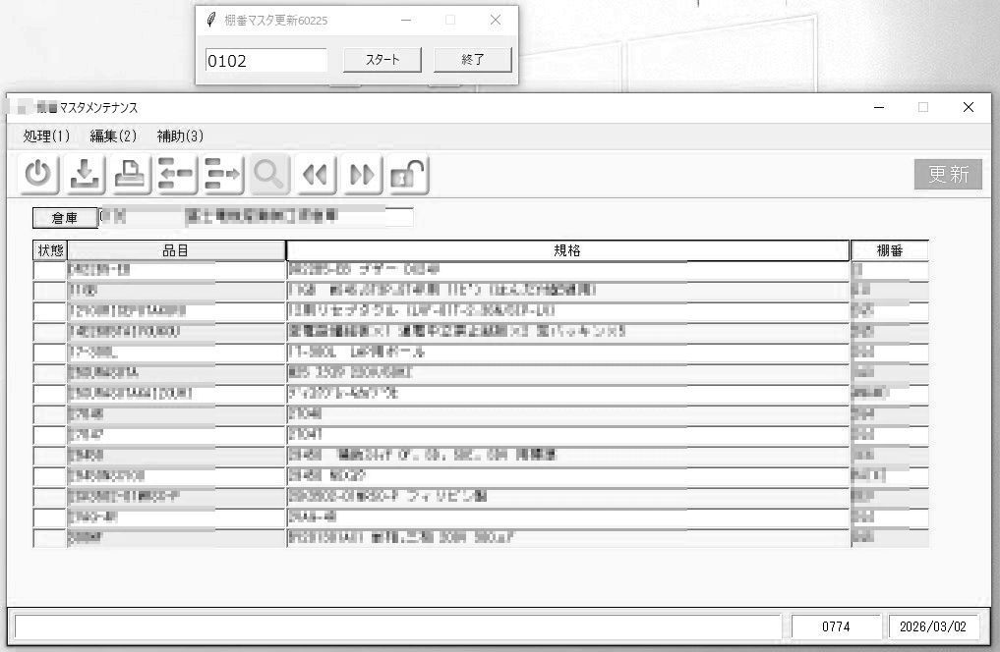
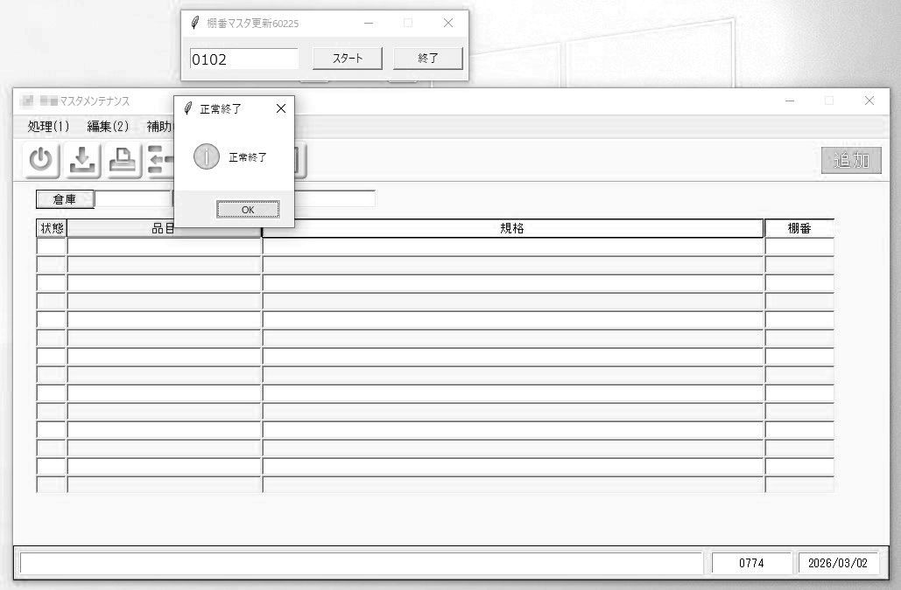
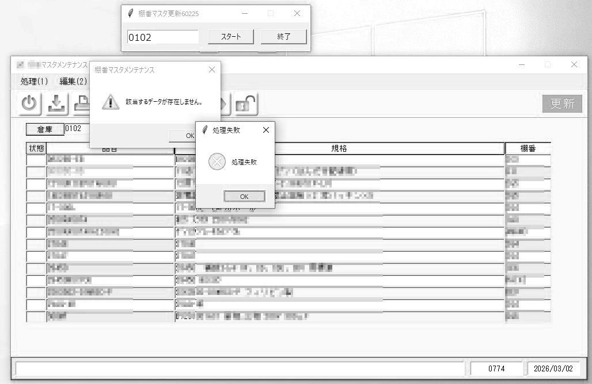

# 物流倉庫の棚番一括更新RPAツール（基幹システム自動化）

## 概要
本プロジェクトは、物流倉庫の移転・引越しに伴う大規模な棚番マスタ変更作業（約12,000件）を迅速かつ正確に行うために開発した、PythonベースのRPA（業務自動化）ツールです。
手作業で行うと膨大な時間と入力ミスが発生する基幹システム（GUI画面）への入力・更新作業を自動化し、現場の業務改善（DX）を推進した実例となります。
このRPAを夜間に使用する事で、約12,000件を自動更新する事が可能となり、人が関わる時間を約12時間→約90分へ短縮（約88%削減）する事が出来、また入力ミス防止の効果も期待できます。

## リポジトリ構成
- `tanaban_rpa_sample.py`: RPAツールのコアソースコード（オープンソース用に一部モック化・リファクタリング済みサンプル）
- `input_sample.xlsx`: 入力データおよび処理ログ記録用のサンプルExcelファイル
- `development_flowchart.md`: 本ツールの開発プロセスを示すフローチャート
- `development_history.md`: 技術検証や設計改善の過程をまとめたドキュメント
- `changelog.md`: 開発履歴（Ver1〜Ver16までの軌跡）
- `ai_utilization.md`: AIを活用したアジャイル開発（Vibe Coding）の取り組みについての解説
- `README.md`: 本説明ドキュメント

## 開発背景と課題
- **背景:** 倉庫移転に伴い、すべての保管品目に対する新しい棚番マスタの再登録が必要となった。
- **課題:** 
  1. 対象データが大量であり、手動入力では多大な工数と人的ミス（入力漏れ・タイポ）のリスクがある。
  2. システム部門へ棚番一括更新機能の実装を依頼していたが、移転日までに間に合うか不透明な状況であった。
  3. 万一、一括更新機能が実装されなかった場合は、基幹システムの画面（GUI）から約12,000件のマスタを1件ずつ更新する必要があり、手作業で行う場合には全ての作業を終えるのに12時間程度かかる見込みであった。

- **解決策:** システム部門による正式な機能追加を待つ一方で、リスク対策としてPythonを用いたRPAツールを独自開発し、必要になれば即座に運用できる体制を整えた。
このツールを夜間に実行する事で人間が作業に関わる時間は90分程度に短縮出来る想定であった

## 画面イメージ・実行フロー

### 1. 処理開始（データ読み込み）
操作用GUIから倉庫コードを入力し、処理を開始します。

### 2. 正常終了ダイアログ
全バッチの処理が完了すると、正常終了メッセージが表示されます。

### 3. 異常検知・安全中断
基幹システム側でエラーが発生した場合、ログを書き残して自動で安全停止します。

## 主な機能
- **簡単操作のGUIフロントエンド:** ユーザーは倉庫コードを入力して「スタート」ボタンを押すだけで自動処理を開始。
- **Excel連携:** 新しい棚番データを記述したExcelファイル（`新棚番.xlsx`）を自動的に読み込んで処理。
- **エラーハンドリング＆ダイアログ検知:** 基幹システム側でエラー（存在しない品目コードなど）が発生した際の警告ダイアログを自動検知。
- **詳細なログ自動書き出し:** 処理完了後、入力Excelファイルに直接「成功/失敗」「詳細メッセージ」「最終更新日時」を上書き記録。

## 動作環境・使用ライブラリ
- Python 3.11+
- `openpyxl` (Excel操作用)
- `pyautogui` / `pywinauto` (GUI自動操作用ライブラリ - サンプルコード内では概念実装)

## この開発で得られた知見

- GUI自動操作による業務改善
- エラー発生時の安全停止設計
- ログ管理の重要性
- AIを活用したアジャイル開発
---
## 作者について
物流部門の現役スタッフとして勤務する傍ら、現場の課題をIT技術（Python, VBA, RPA）で解決する「現場発の業務改善」を得意としています。
